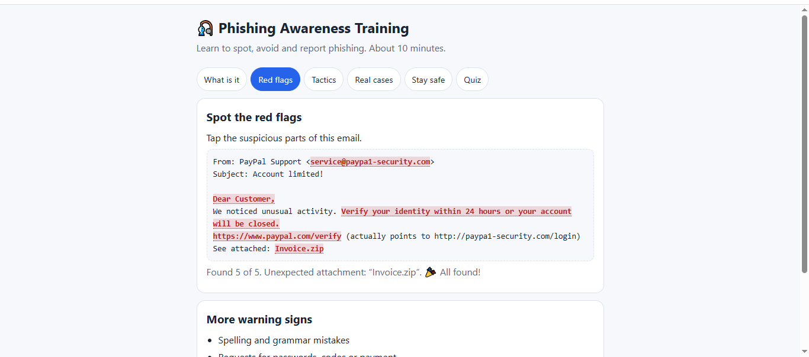
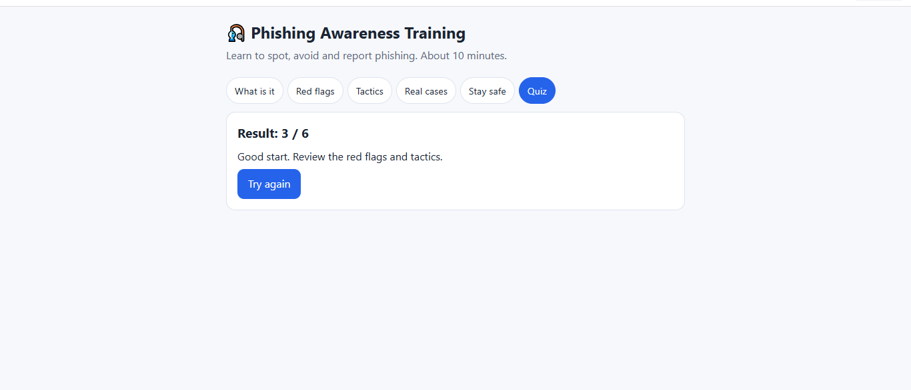

# CodeAlpha_PhishingAwareness

Interactive phishing awareness training module built for the CodeAlpha Cyber Security internship (Task 2) by Syeda Haniya Zahra

## What it covers
- **What is phishing:** email, spear phishing, whaling, smishing, vishing, fake websites, QR phishing
- **Red flags:** interactive fake email where you tap the suspicious parts
- **Social engineering tactics:** urgency, fear, authority, greed, pretexting
- **Real cases:** RSA (2011), Target (2013), Google and Facebook invoice scam (2013-15), Twitter (2020)
- **Best practices:** hovering over links, verifying senders, password managers, MFA, what to do if you clicked
- **Quiz:** 6 questions with instant feedback and a score

## How to use
Open `index.html` in any web browser. No installation needed.

## Live demo
https://haniyazahra51.github.io/CodeAlpha_PhishingAwareness/

## Screenshots

## Built with
HTML, CSS and JavaScript (single file, no dependencies).

## Disclaimer
For education and awareness only.
